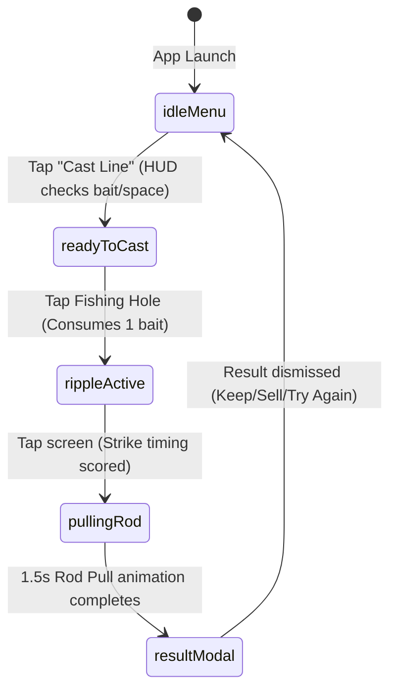

# 🎣 Junk Fishing

An Android-only casual/gacha collection game built with Flutter.

Instead of fishing for normal aquatic life, the player dredges up weird, absurd artifacts, obsolete technology, and bizarre curiosities from polluted waterways and forgotten wells.

---

## 🎮 Core Gameplay Loop

The game operates strictly on a **single-screen Stack state machine** on `MainFishingScreen`:



1. **`idleMenu`**: Left-side drawer menu (`Fish`, `Inventory`, `Collections`, `Map`, `Settings`) and top scrap coin HUD.
2. **`readyToCast`**: Menu recedes; an animated target prompt highlights the stone-lined fishing well.
3. **`rippleActive`**: The world blurs into the **Torchlight-style timing minigame**. Outer rings tease and wander organically. When the circle turns glowing **orange**, the player taps anywhere on screen to hook. Failing to tap safely resets the cycle without game over.
4. **`pullingRod`**: 1.5-second cinematic rod bending tension animation with line vibration and water splashes.
5. **`resultModal`**:
   - **Success**: Vintage Polaroid discovery card showing the item, rarity stars (★ - ★★★★★), value, weight, and flavor text, with options to **Keep**, **Sell**, or **Share**.
   - **Fail**: Comic speech bubble (*"Caught nothing..."*) with cartoon wobble.

---

## 🏗️ Architecture & Layering

The codebase is strictly structured by concerns to prevent architectural drift:

```
lib/
├── engine/                      # Pure Dart game mechanics (zero Flutter UI)
│   ├── fishing_timing_engine.dart   # Headless Torchlight ring simulation & tease logic
│   └── loot_engine.dart             # Weighted drop roller & rarity calculations
├── models/                      # Pure Dart data contracts & enums
│   ├── fishing_state.dart           # Single-screen Stack state machine enum
│   ├── item.dart                    # Absurd item specifications & rarity stars
│   ├── location.dart                # Fishing zones, difficulties, & drop tables
│   ├── collection.dart              # Milestone collection sets & coin rewards
│   └── player_state.dart            # Persistent player wallet, bait & inventory
├── services/                    # Local storage & JSON loading
│   └── game_data_service.dart       # JSON asset loader & SharedPreferences persistence
├── rendering/                   # Modular CustomPainters & visual canvas layers
│   └── scene_painters.dart          # Environment, Lantern, FishingHole & Fisherman painters
├── utils/                       # Visual helpers
│   └── item_icon_helper.dart        # Dynamic Material icons & rarity palette
├── widgets/                     # Presentation overlays and bottom sheets
│   ├── isometric_world.dart         # Top-down isometric scene with stone well & fisherman
│   ├── ripple_timing_overlay.dart   # Interactive Torchlight timing overlay widget
│   ├── polaroid_result_card.dart    # Retro Polaroid discovery card modal
│   ├── comic_speech_bubble.dart     # Comic fail speech bubble
│   ├── collapsible_nav_menu.dart    # Collapsible left navigation drawer & top HUD
│   └── modals/                      # Bottom sheets (inventory, collections, map, settings)
├── screens/
│   └── main_fishing_screen.dart     # State machine coordinator & root Stack layer
└── main.dart                        # Portrait-locked entrypoint
```

---

## 🎯 Architectural Principles (Non-Negotiable)

1. **Mobile Portrait First**: Designed exclusively for touch ergonomics on Android portrait mobile screens.
2. **100% Deterministic & Local**: All mechanics, loot tables, drop odds, collection criteria, and locations are driven by local JSON data in `assets/data/`. No external servers or telemetry.
3. **Single-Screen Stack**: Navigation stays strictly inside `MainFishingScreen`. Modals are secondary bottom sheets or overlays on top of the state machine.
4. **AI-Maintained**: Built and maintained under the strict governance rules defined in [AGENTS.md](file:///k:/Android/junk_fishing/AGENTS.md).

---

## 📦 Data Files (`assets/data/`)

- **`items.json`**: Absurd item definitions, rarities (1 to 5 stars), scrap values, collection tags, and weights.
- **`locations.json`**: Fishing zones, difficulty multipliers, water/theme color schemes, and available item drop pools.
- **`collections.json`**: Thematic scrap collections with coin rewards upon completion.

---

## 🛠️ Development & Quality Verification

Run Flutter static analysis (strict zero-warning policy):
```powershell
flutter analyze
```

Run automated unit and widget test suites:
```powershell
flutter test
```

Build debug APK:
```powershell
flutter build apk --debug
```

Launch on Android emulator:
```powershell
flutter emulators --launch Pixel_10a
flutter run -d emulator-5554
```

---

## 📜 Maintenance Charter

Every modification, bugfix, or new feature must strictly conform to [AGENTS.md](file:///k:/Android/junk_fishing/AGENTS.md) and be documented in [CHANGELOG.md](file:///k:/Android/junk_fishing/CHANGELOG.md).
